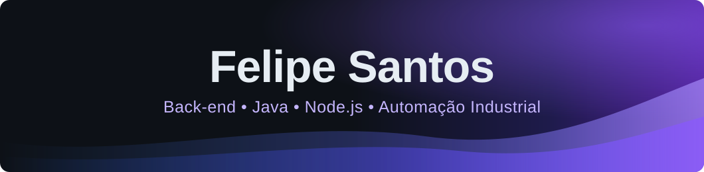
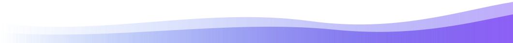

 

---

<h3 align="center"><code>✦ um pouco sobre mim ✦</code></h3>

Sou estudante de **Engenharia de Software na FIAP**, com foco em **back-end (Node.js e Java/Spring Boot)**. Trabalho com **manutenção industrial**, então gosto de software que resolve problema de fábrica: dado de processo, alarme, sinótico e integração com CLP.

Atualmente, meu foco está em:

- 🟣 Back-end com **Node.js** e **Java/Spring Boot**
- 🔌 APIs REST e integração com **PostgreSQL**
- 🏭 **Gêmeos digitais** e sinóticos web para processos industriais
- ⚙️ Automação com **CLP Siemens**, **ESP32 (C++)** e dashboards
- 🐳 Containers com **Docker**

---

<h3 align="center"><code>♡ tecnologias</code></h3>

**Linguagens & Back-end**

**Dados & Infra**

**Front-end**

---

<h3 align="center"><code>⚙ ferramentas que fazem parte do meu dia</code></h3>

---

<h3 align="center"><code>✦ projetos</code></h3>

Alguns dos projetos que representam minha jornada de desenvolvimento.

<table>
<tr>
<td width="50%" align="center" valign="top">

<h3>🏭 Papermill-Twin</h3>

Gêmeo digital web de uma máquina de papel, com sinótico interativo e interface moderna.

</td>
<td width="50%" align="center" valign="top">

<h3>🛗 ElevOS</h3>

Plataforma de diagnóstico para elevadores antigos sem IoT, desenvolvida em um challenge da FIAP.

</td>
</tr>
<tr>
<td colspan="2" align="center" valign="top">

<h3>🌐 meu-portfolio</h3>

Portfólio pessoal com projetos, stack e contato.

</td>
</tr>
</table>

<!-- Quando publicar uma API (Spring Boot + PostgreSQL + Docker), adicione aqui um novo card no mesmo formato. -->

---

<h3 align="center"><code>♡ contribution garden</code></h3>

<picture>
  <source media="(prefers-color-scheme: dark)" srcset="https://raw.githubusercontent.com/felipe-santos-dev/felipe-santos-dev/output/github-snake-dark.svg" />
  <source media="(prefers-color-scheme: light)" srcset="https://raw.githubusercontent.com/felipe-santos-dev/felipe-santos-dev/output/github-snake.svg" />
  
</picture>

---

<h3 align="center"><code>✉ vamos conversar?</code></h3>

  

Back-end • APIs • Dados • Automação industrial

 

Do chão de fábrica ao código, com um toque de roxo. 💜

